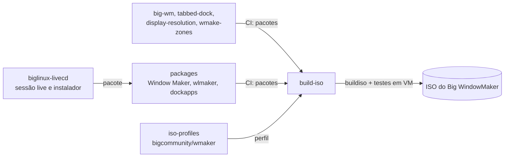

<p align="center">
  
</p>

<h1 align="center">iso-profiles — edição Big WindowMaker</h1>

<p align="center">
  <b>O perfil da ISO do Big WindowMaker (<code>bigcommunity/wmaker</code>).</b><br>
  Fork de <a href="https://github.com/big-comm/iso-profiles">big-comm/iso-profiles</a>, os perfis das edições da BigCommunity.
</p>

<p align="center">
  
  <a href="https://github.com/big-comm/iso-profiles"></a>
  
</p>

<p align="center">
  <a href="#a-edição-big-windowmaker">A edição</a> ·
  <a href="#da-lista-de-pacotes-à-iso">Como vira ISO</a> ·
  <a href="#capturas-da-iso">Capturas</a> ·
  <a href="#testar">Testar</a> ·
  <a href="#contribuir">Contribuir</a> ·
  <a href="#créditos">Créditos</a> ·
  <a href="#bigcommunity-iso-profiles">Documentação original (English)</a>
</p>

## A edição Big WindowMaker

`bigcommunity/wmaker/` descreve a ISO do Big WindowMaker: o desktop
Window Maker (X11) e wlmaker (Wayland) do
[big-wm](https://github.com/big-windowmaker/big-wm) sobre a base BigLinux /
BigCommunity / Manjaro.

| Arquivo | O que define |
|---|---|
| `bigcommunity/wmaker/Packages-Desktop` | os pacotes da edição: sessões, Window Maker, wlmaker, dockapps, temas, aplicativos |
| `bigcommunity/wmaker/profile.conf` | nome da máquina, usuário live, argumentos de boot |
| `bigcommunity/wmaker/Desktop-remove`, `Root-remove` | o que a edição tira das listas comuns |
| `bigcommunity/wmaker/*-overlay/` | arquivos da edição (os demais são links para `shared/`) |

> **Atenção:** quase tudo em `bigcommunity/wmaker/` que não é
> `Packages-Desktop` ou `profile.conf` é **link simbólico para `shared/`**.
> Mudar o destino muda **todas as edições**. Confira com `ls -l` antes de
> gravar e, para algo só do Big WindowMaker, use os arquivos da edição.

## Da lista de pacotes à ISO



O [build-iso](https://github.com/big-windowmaker/build-iso) junta os pacotes
dos outros repositórios num repositório local, lê este perfil e gera a ISO;
depois a inicia em máquinas virtuais (BIOS e UEFI) até a sessão live e testa
a instalação pelo Calamares.

## Capturas da ISO

ISO de teste (Alpha), máquina virtual, 06/11/2026:

| | |
|---|---|
|  |  |
| GRUB da ISO | Sessão live |
|  |  |
| Login: X11 ou Wayland | Sistema instalado, sessão Wayland |

## Testar

```sh
python -m pytest tests     # contratos do GRUB, nome da edição, login live, pacman.conf, tema
```

Os testes também rodam no build-iso antes de cada ISO.

## Contribuir

- Pacote novo só no Big WindowMaker: `bigcommunity/wmaker/Packages-Desktop`
  (confira o nome com `pacman -Si`).
- Mudança que vale para todas as edições: proponha ao
  [projeto original](https://github.com/big-comm/iso-profiles).
- Problemas da ISO: [build-iso](https://github.com/big-windowmaker/build-iso/issues);
  guia: [CONTRIBUTING](https://github.com/big-windowmaker/.github/blob/main/CONTRIBUTING.md).

## Créditos

**Projeto original — BigCommunity:** Tales A. Mendonça
([@talesam](https://github.com/talesam)),
[@narayanls](https://github.com/narayanls),
[@leoberbert](https://github.com/leoberbert) e a comunidade BigCommunity.

**Mantenedores do Big WindowMaker:** Rafael Ruscher <rruscher@gmail.com> e
Barnabé Di Kartola <barnabedikartola@gmail.com>.

**Agradecimentos especiais:** Alfredo Kojima (pelo
[Window Maker](https://www.windowmaker.org/)), Philipp Kaeser (pelo
[wlmaker](https://github.com/phkaeser/wlmaker)), Bruno Gonçalves (pelo
[BigLinux](https://www.biglinux.com.br/)) e Tales A. Mendonça (pela
[BigCommunity](https://communitybig.org)).

**Licença:** o projeto original não declara licença, e este fork não pode
licenciar os arquivos dele. As contribuições do Big WindowMaker seguem a
licença que o projeto original adotar.

---

<p align="center">
  
</p>

# BigCommunity iso-profiles

Package lists and overlay files that describe a BigCommunity ISO. This
repository does not build ISOs — `buildiso` (manjaro-tools) reads
`bigcommunity/<edition>/` from it.

## The one rule

```
shared/         <- what applies to every edition
bigcommunity/   <- one directory per edition; the rest is symlinks into shared/
```

No CI generates `bigcommunity/`: everything here is edited by hand. What keeps
it from being duplicated is **symlinks** — 140 of them today. Each edition's
`Packages-Root`, `Packages-Live`, `Packages-Mhwd` and `user-repos.conf` point at
`../../shared/`, and the overlays link directory by directory
(`live-overlay/usr`, `desktop-overlay/etc`, …). Editing `shared/Packages-Root`
changes every edition at once, which is what you usually want.

## Layout

```
shared/
├── Packages-Root            installed-system packages (common base)
├── Packages-Live            live session only
├── Packages-Mhwd            offline driver repository (/opt/mhwd), installed by big-driver-manager-cli
├── profile.conf             template: services, live user, label
├── pacman.conf              shipped as /etc/pacman.conf by the overlays
├── user-repos.conf          BigCommunity pacman repositories
├── root-overlay/            files for the installed system
├── desktop-overlay/         files for the desktop image
├── live-overlay/            live session only (GRUB, calamares, memtest)
├── grub-assets/icons/       live GRUB menu icons
└── grub-i18n/               po/ + LINGUAS + update-translations.sh

bigcommunity/
└── kde/  gnome/  xfce/  cinnamon/  wmaker/  cosmic/  deepin/  hyprland/  core/
    ├── Packages-Desktop     the ONLY package file the edition owns
    ├── profile.conf         hostname, live user, custom_boot_args
    ├── Desktop-remove       (optional) removals from the desktop list
    ├── Root-remove          (optional) removals from the root list
    ├── *-overlay/           links into shared/ plus its own files
    └── Packages-{Root,Live,Mhwd}, user-repos.conf  -> ../../shared/
```

## What to edit

| Goal | Edit |
|---|---|
| Add a package to every edition | `shared/Packages-Root` |
| Change a live-session-only package | `shared/Packages-Live` |
| Change a driver package | `shared/Packages-Mhwd` |
| Change an edition's desktop | `bigcommunity/<edition>/Packages-Desktop` |
| Drop a package in one edition only | `bigcommunity/<edition>/Desktop-remove` or `Root-remove` |
| Ship a file in the installed system | `shared/root-overlay/` |
| Ship a file only in the live session | `shared/live-overlay/` |
| Change the live user, password or hostname | `bigcommunity/<edition>/profile.conf` |
| Change the live GRUB menu | `shared/live-overlay/usr/share/grub/cfg/` |

Push and build an ISO — there is no bot and no intermediate step.

## Three things that surprise people

**Editing inside one edition may edit them all.** `bigcommunity/kde/Packages-Root`
is a symlink to `shared/Packages-Root`. An editor that follows the link writes to
the shared file; one that replaces the file breaks the link and that edition
starts drifting from the others silently. Check with `ls -l` first.

**Every edition's `profile.conf` is a real file.** `shared/profile.conf` is the
reference template, not the source: editions override `hostname`, `username`,
`password` and `custom_boot_args` (KDE, for instance, boots with `wayland`).
Editing only `shared/profile.conf` changes no ISO.

**`core` swaps the files around.** Its `Packages-Desktop` holds a single line
(`btop`); the entire desktop — Cinnamon, themes, input drivers, udev rules —
lives in its own `Packages-Live`, which is not a link into `shared/`. Looking for
a core package in `Packages-Desktop` finds nothing.

## Live session GRUB

The live menu lives in `shared/live-overlay/usr/share/grub/` (`cfg/`, `themes/`
and `locales/`) and is translated from `shared/grub-i18n/` — 28 languages listed
in `LINGUAS`, regenerated by `update-translations.sh`.

The `wmaker` edition keeps the shared menu but swaps the theme: its
`live-overlay/usr/share/grub/cfg/` links every shared `.cfg` and adds
`profile.cfg` (sourced by the shared `grub.cfg`, loads the theme's fonts), and
`themes/bigcommunity-live/` — the only theme directory `buildiso` copies — holds
the Big WindowMaker theme generated by `make grub-theme-live` in
big-windowmaker/big-wm. Its installed system picks `grub-theme-big-wm` and
`plymouth-theme-big-wm` through `root-overlay/etc/default/grub.d/` and
`root-overlay/etc/plymouth/plymouthd.conf`.

That menu's contracts (boot arguments, module blacklist, expected entries,
themes present) are covered by tests:

```bash
pytest tests/     # 27 tests, ~0.3 s
```

Run them after touching anything under `live-overlay/`.

## Reference

`repo_info` in the root is not documentation: `manjaro-tools` finds a profile
repository by searching for exactly that file.

`root-overlay/` lands in the installed system, `desktop-overlay/` in the desktop
image, `live-overlay/` only in the live session — the names are fixed, they are
what `manjaro-tools` expects to find.

Repositories come from `user-repos.conf`. A profile-level `pacman-default.conf`
is never read, which is why this repository does not ship one.

In `Packages-*`, `>extra`, `>multilib` and `>i686` are manjaro-tools target
markers, and `KERNEL` is a placeholder, not a package: `buildiso -k linux612`
expands `KERNEL-broadcom-wl` into `linux612-broadcom-wl`. Leave it as `KERNEL`.

## Credits

Big WindowMaker development:

- **Rafael Ruscher** — <rruscher@gmail.com>
- **Barnabé Di Kartola** — <barnabedikartola@gmail.com>

